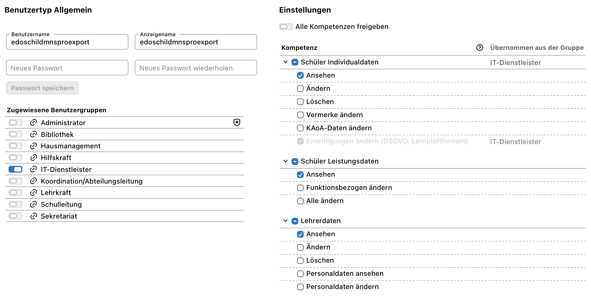

# Schild-NRW / SVWS Schüler- und Lehrerexport

Node.js ab Version 22.12. Abhängigkeiten einmalig mit `npm install` installieren.

## Exportbenutzer im SVWS-Server einrichten

1. Auf dem Server unter **Einstellungen → Benutzer** einen neuen Benutzer anlegen,
   beispielsweise `edoschildmnsproexport`.
2. Ein Passwort vergeben und notieren.
3. Die Benutzergruppe **IT-Dienstleister** auswählen.
4. Folgende Rechte setzen: **Schüler Individualdaten ansehen**,
   **Schüler Leistungsdaten ansehen** und **Lehrerdaten ansehen**.
5. Die Änderungen speichern.

Als Orientierung für die Benutzereinrichtung:



Den Export mit dem angelegten Benutzer starten:

```sh
npm run export -- --insecure --user edoschildmnsproexport
```

Das CLI fragt anschließend verdeckt nach dem notierten Passwort.

## Aufruf und Optionen

```sh
npm run export -- --insecure --password 'dein-passwort'
```

Verbindet sich mit `https://127.0.0.1:8443`, Benutzer `admin`.
Das Passwort kann über `--password` oder eine nicht leere
Umgebungsvariable `SVWS_PASSWORD` gesetzt werden. Das Argument hat Vorrang.
Ohne Passwortangabe fragt das CLI im Terminal verdeckt danach (keine Zeichenanzeige).
Ohne interaktives Terminal muss `--password` oder `SVWS_PASSWORD` gesetzt sein.
Für den Testserver ohne Passwort bei der Abfrage Enter drücken oder `--password ''` angeben.
Passwörter als Argument können im Shell-Verlauf und in der Prozessliste sichtbar sein.
Das Standardschema wird automatisch ermittelt. `--insecure` akzeptiert das
selbstsignierte Zertifikat dieses Testservers ausschließlich für diese Verbindung.

```sh
SVWS_PASSWORD='passwort' npm run export -- --schema gymabi --output output/Student.csv --insecure
npm run export -- --help
npm test
```

Die Ausgabe enthält `ReferenzId;Vorname;Nachname;Klasse;Gruppen`, UTF-8 mit BOM,
CRLF-Zeilenumbrüche und Semikolon als Trennzeichen. Bestehende Zieldateien werden erst
nach vollständig erfolgreichem Abruf ersetzt. Der Server wird nur lesend angesprochen.

Exportiert werden aktive Schüler (Status 2) des aktuell in SVWS eingestellten
Schuljahresabschnitts; `--all-status` nimmt auch andere Status auf. Gruppen stammen
aus den Kurszuordnungen, benannt als `Jahrgang - Kurskürzel`, verbunden durch `|`.
Mehrere Kursjahrgänge werden durch `/` verbunden. Reiner Klassenunterricht ohne
Kurszuordnung wird nicht als Gruppe ergänzt. Ohne Klasse bleibt das Klassenfeld leer.

Die Schülerliste der API liefert keine GUID. ReferenzIds sind deshalb deterministische
UUIDs v5 aus Schema und interner Schüler-ID. Sie bleiben bei wiederholten Exporten
gleich, sind aber keine Übernahme vorhandener Schild-/MNSpro-GUIDs. Schemawechsel oder
neu vergebene Schüler-IDs ändern die Referenzen. Vor einer Anbindung bereits vorhandener
MNSpro-Konten muss deren ID-Zuordnung abgestimmt werden.

Zusätzlich entsteht `output/Teacher.csv` (anpassbar mit `--teacher-output DATEI`).
Alle Lehrkräfte des aktuellen Schuljahresabschnitts mit `istAktiv === true` und `istSichtbar === true`
werden exportiert, auch ohne Kurse oder Klassenleitung. Mit `--all-status` werden auch inaktive und unsichtbare Lehrer aufgenommen.
Der Parameter gilt gemeinsam für Schüler und Lehrer; die Auswahl bleibt auf die
vom Server für den aktuellen Abschnitt gelieferten Personen beschränkt.
`istRelevantFuerStatistik` wird nicht als Filter verwendet.

```sh
npm run export -- --insecure --password 'dein-passwort' --all-status
```
Klassenleitungen stehen als `^Klassenkürzel` in `Klassen`, mehrere getrennt durch `|`.
Die Gruppen enthalten die Kurse als Haupt- oder zusätzliche Lehrkraft.
Ohne Zuordnungen bleiben die entsprechenden Felder leer. Lehrer-UUIDs verwenden
einen separaten Namensraum innerhalb des Referenzschlüssels, sodass gleiche interne
Schüler- und Lehrer-IDs unterschiedliche Referenzen erzeugen.


## Svelte-SPA

Die Browseroberfläche existiert neben dem CLI und nutzt dieselbe CSV-Erzeugung.
Über **Hilfe** in der Kopfzeile ist die Anleitung zur SVWS-Benutzereinrichtung
mit Screenshot und Hinweisen zu Verbindungsfehlern erreichbar.

```sh
npm install
npm run dev
```

Die im Terminal angezeigte URL öffnen (standardmäßig `http://127.0.0.1:5173`).

1. Zugangsdaten eingeben. Das Datenbankschema kann leer bleiben, dann wird das
   Standardschema verwendet. „Verbinden“ lädt die Daten des aktuellen Abschnitts.
2. Lehrer prüfen: „Nur aktive Lehrer“ und „Nur sichtbare Lehrer“ lassen sich
   unabhängig schalten. Lehrer ohne Kurse sind enthalten. CSV herunterladen.
3. Zu Schülern wechseln, bei Bedarf den Aktivfilter ausschalten und CSV herunterladen.

Die Filter laufen lokal im Browser. Der Server bestimmt den aktuellen Abschnitt.
Die Suche findet Vor- und Nachnamen, Klassen und Gruppen unabhängig von Großschreibung.
Mehrere Suchbegriffe können kombiniert werden, etwa `Max Q2`. Die Suche grenzt die Liste zusätzlich ein; der Download enthält genau die angezeigten
Einträge. Die Schülerliste der API hat keinen Sichtbarkeitsparameter.

Zugangsdaten einschließlich Passwort werden standardmäßig im `sessionStorage`
gespeichert. „Zugangsdaten dauerhaft speichern“ überträgt sie in den `localStorage`.
Beim Ausschalten werden sie zurück in den Session-Speicher übertragen und aus dem
permanenten Speicher gelöscht. Im Browser gespeicherte Passwörter sind nicht verschlüsselt.
Schüler- und Lehrerdaten werden nur im Arbeitsspeicher gehalten.

Der Vite-Proxy leitet `/svws` an `https://127.0.0.1:8443` weiter und akzeptiert
standardmäßig das selbstsignierte Testzertifikat. Anderen Server konfigurieren:

```sh
SVWS_TARGET=https://svws.example.org:8443 SVWS_VERIFY_TLS=true npm run dev
```

Der Server kann auf der Zugangsseite als HTTPS-Adresse mit optionalem Port geändert werden.
Die Auswahl gilt sofort beim nächsten Verbinden und wird zusammen mit den Zugangsdaten gespeichert.
`SVWS_TARGET` legt nur den Anfangswert des SPA-Eingabefelds fest.
Die SPA übergibt die ausgewählte Adresse bei jeder Anfrage: im Browser über
`X-SVWS-Server`, in Tauri als `server`-Argument. Beide Proxys haben kein festes
Ziel und keine Ersatzadresse; ohne Ziel wird die Anfrage abgewiesen.
Rust enthält keine einkompilierte SVWS-Serveradresse. Die Oberfläche wird nur auf `127.0.0.1` bereitgestellt.
`npm run build` erzeugt die SPA in `dist/`. Für eine spätere Bereitstellung benötigt
auch der Webserver einen entsprechenden `/svws`-Reverse-Proxy; dieser wird nicht in
statische Build-Dateien eingebaut. Derzeit ist `npm run dev` der vollständige lokale Startweg.

## Projektstruktur und TypeScript

```text
scripts/export.ts       CLI-Einstiegspunkt
src/cli/                CLI und verdeckte Passwortabfrage
src/web/                Svelte-SPA, API-Zugriff, Suche, Speicher und Assets
src/shared/             Gemeinsame Datentypen, CSV-Erzeugung und Klassenabruf
test/                   TypeScript-Tests
vite.config.ts          Vite und SVWS-Proxy
tsconfig.json           Strikte TypeScript-Konfiguration
```

`npm run export -- …` startet das CLI über den TypeScript-Loader `tsx`.
`npm run check` prüft TypeScript und Svelte. `npm test` führt die Tests aus.
`npm run build` prüft zuerst die Typen und erzeugt anschließend den Web-Build.
`npm run dev` startet weiterhin die SPA mit dem Vite-Proxy.

## Tauri-Desktop-App

Die Desktop-Hülle liegt zusätzlich unter `src-tauri/`. Die TypeScript-Struktur,
das CLI und die Browser-SPA bleiben bestehen. Voraussetzung für Desktop-Builds:
Rust/Cargo und die [Tauri-Systemvoraussetzungen](https://v2.tauri.app/start/prerequisites/)
(z. B. Xcode Command Line Tools auf macOS).

```sh
npm install
npm run desktop:dev
npm run desktop:build
npm run desktop:test
```

`desktop:dev` startet einen eigenen Vite-Server auf Port 1420 und das native Fenster.
`desktop:build` erstellt auf macOS die App unter
`src-tauri/target/release/bundle/macos/SVWS CSV Export.app`.
Die App enthält die Oberfläche und benötigt danach weder Vite noch Node.js.
Der Build ist für lokale Nutzung; eine signierte/notarisierte Veröffentlichung
ist nicht eingerichtet. Andere Betriebssysteme benötigen passende Bundle-Ziele
in `src-tauri/tauri.conf.json` und einen Build auf dem jeweiligen System.

Im Desktop-Modus ruft die Oberfläche den Rust-Befehl `svws_get` auf. Dieser sendet
nur GET-Anfragen an die benötigten SVWS-Exportendpunkte, mit 30 Sekunden Timeout
und ohne HTTP-Weiterleitungen. CORS-Header des SVWS-Servers sind damit nicht nötig.
Im Browser wird weiterhin der Vite-Proxy verwendet. CSV-Dateien werden in der
Desktop-App über einen nativen Speichern-Dialog abgelegt.

Der Anfangswert des Serverfeldes und die TLS-Prüfung können beim Start bzw. Build gesetzt werden:

```sh
SVWS_TARGET=https://svws.example.org:8443 SVWS_VERIFY_TLS=true npm run desktop:build
```

Ohne diese Variablen gilt weiterhin der lokale Testserver
`https://127.0.0.1:8443` mit akzeptiertem selbstsigniertem Zertifikat.
Ein anderes Ziel kann direkt im Serverfeld eingegeben werden; dafür ist kein Neubau nötig.
Die TLS-Prüfung bleibt über `SVWS_VERIFY_TLS` konfiguriert.
Die Abbrechen-Schaltfläche beendet das Warten in der Oberfläche; bereits laufende
Rust-Anfragen enden spätestens nach dem Timeout. Zugangsdaten werden wie in der SPA
im Session- oder lokalen Speicher der Desktop-WebView gehalten. Dieser Speicher
ist unabhängig vom Browser-Speicher und nicht verschlüsselt.

## GitHub-Builds und Releases

`.github/workflows/release.yml` führt bei Branch-Pushes, Pull Requests und manuellem
Start die TypeScript-Tests, Typprüfung und Web-Build aus. Anschließend werden die
Tauri-Pakete für alle sieben Desktop-Ziele gebaut und Rust-Tests ausgeführt.
Die Installer sind 14 Tage als Workflow-Artefakte verfügbar.

| System | Architektur | Pakete |
| --- | --- | --- |
| macOS | Apple Silicon, Intel | DMG |
| Linux | x64, ARM64 | DEB, RPM, AppImage |
| Windows | x64, x86 (32 Bit) | NSIS EXE, MSI |
| Windows | ARM64 | NSIS EXE |

Die Matrix verwendet [GitHub-hosted Runner](https://docs.github.com/en/actions/reference/runners/github-hosted-runners)
und die offizielle [Tauri-Build-Action](https://github.com/tauri-apps/tauri-action).
Android und iOS sind nicht Teil dieser Desktop-App.

Ein gepushter Versions-Tag erzeugt zusätzlich ein GitHub-Release:

```sh
git tag v0.2.0
git push origin v0.2.0
```

RPM wird nach dem Build separat aus dem vorhandenen Programm paketiert. Dabei
wird beispielsweise `0.1.0-alpha.2` in RPM-Version `0.1.0` und Release
`0.alpha.2` übersetzt; stabile Versionen erhalten Release `1`. So bleiben
Prereleases vor der stabilen Version einsortiert. Die kompilierte App sowie
DEB und AppImage behalten die vollständige Tag-Version.

`v0.2.0-beta.1` erzeugt ein Prerelease. Die Tag-Version wird im temporären
CI-Checkout in die Tauri-Konfiguration übernommen. Für MSI wird separat die
numerische Basisversion verwendet (z. B. `0.2.0` bei `v0.2.0-beta.1`), da WiX
keine textuellen Prerelease-Zusätze akzeptiert. Prereleases derselben Basisversion
haben damit dieselbe MSI-Produktversion; für eindeutig unterscheidbare MSI-Updates
die Basisversion erhöhen. Major und Minor dürfen höchstens 255, Patch höchstens
65535 sein. Erst wenn **alle** Builds und
Tests erfolgreich sind, werden sämtliche Installer hochgeladen und das Release
veröffentlicht. Ein bereits veröffentlichtes Release wird nicht überschrieben;
einen neuen Tag verwenden. Ein unterbrochener Upload bleibt als Entwurf bestehen
und kann durch erneutes Ausführen fortgesetzt werden.

Der automatisch bereitgestellte `GITHUB_TOKEN` genügt. Nur der Release-Job erhält
`contents: write`; die Repository-/Organisationsrichtlinie muss dies erlauben.
Es sind keine Server-Zugangsdaten nötig. Installer sind noch nicht mit einem
Herstellerzertifikat signiert, macOS-Builds nicht notarisiert. Der tatsächliche
plattformübergreifende Durchlauf muss nach dem Push auf GitHub geprüft werden.

Hinweis: Dieser Code wurde mit KI-Unterstützung erstellt.
